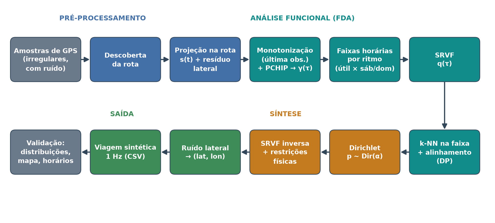
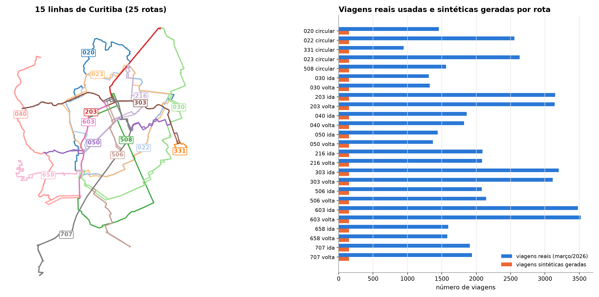
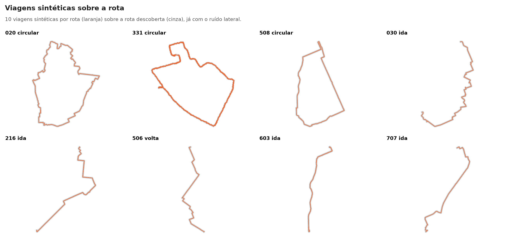
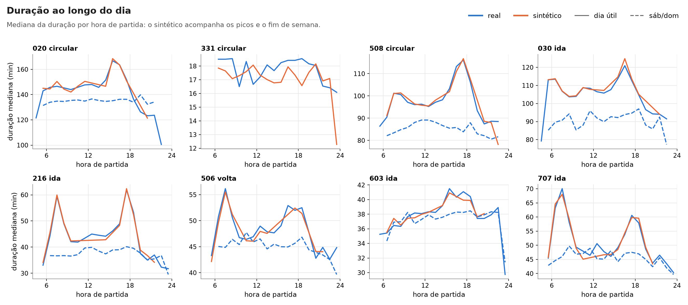
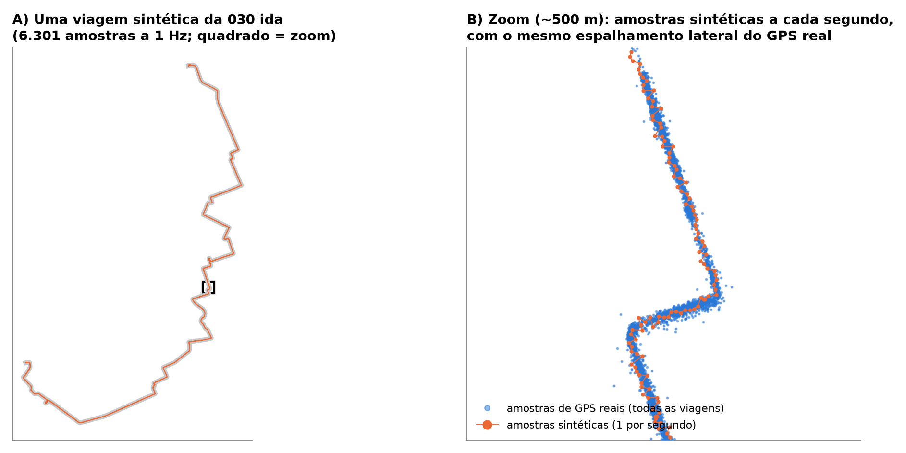
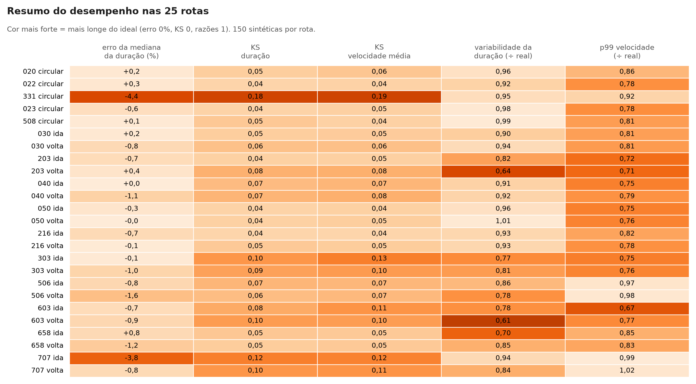

# GPS sintético de ônibus (Curitiba)

Gerador de viagens sintéticas de ônibus em linha, com amostras de GPS a 1 Hz,
baseado no FDASynthesis (Burzacchi et al., 2024,
[arXiv:2410.12514](https://arxiv.org/abs/2410.12514)) e adaptado ao caso de
ônibus urbanos. Os dados reais são as posições dos ônibus de Curitiba em
março/2026, do [portal de dados abertos da URBS](https://dadosabertos.c3sl.ufpr.br/curitibaurbs).



## Resultado em resumo

- **15 linhas, 25 rotas** (5 circulares e 10 ida/volta), de 4 a 45 km.
- **53.320 viagens reais** no banco e **3.750 viagens sintéticas** (150 por rota),
  com **14,8 milhões de amostras de GPS a 1 Hz**.
- Erro da mediana da duração: **−0,7% em média**. Em 23 das 25 rotas o erro fica
  dentro de ±1,6%. As piores rotas são a 331 (−4,4%) e a 707 ida (−3,8%).
- Os testes KS de duração e de velocidade média dão em média 0,070 e 0,073.
- As sintéticas não são cópias das reais: a distância à viagem real mais próxima
  (DCR) é 0,69 da distância entre duas viagens reais.
- 8 de 8 testes automáticos da síntese passam
  ([verificacao_dirichlet.txt](pipeline/resultados/verificacao_dirichlet.txt)).



## Como o modelo funciona

Para cada rota (linha × sentido):

1. **Rota.** A geometria é descoberta a partir das próprias amostras de GPS (modelo v11)
   e comparada com o traçado oficial da URBS.
2. **Projeção.** Cada amostra de GPS é projetada na rota, o que dá a posição `s` (m) ao
   longo do percurso. Nas linhas circulares, a volta é desenrolada pela soma dos
   deslocamentos com sinal. Assim, uma amostra alguns metros atrás da anterior não
   vira um salto de uma volta inteira.
3. **Monotonização por última observação.** O ruído do GPS faz `s(t)` voltar
   para trás. O modelo repete a última posição válida (máximo acumulado). Antes disso,
   descarta amostras isoladas projetadas mais de 100 m à frente de alguma das 3
   amostras seguintes. Sem esse descarte, o máximo acumulado "congela" num salto falso.
4. **Curva γ(τ).** O PCHIP interpola `s(t)`, que é normalizado em tempo e em
   distância: `γ(τ) = (s − s0)/S`, com `τ = (t − t0)/T`.
5. **Faixas horárias por ritmo.** O dia é dividido, por rota e separadamente
   para dia útil e sábado/domingo, onde a duração das viagens muda. Isso é feito
   por partição ótima em programação dinâmica com penalidade BIC (ver
   [docs/faixas_horarias.md](docs/faixas_horarias.md)).
6. **k-NN elástico.** Uma viagem real da faixa é sorteada como âncora. Os K = 4
   vizinhos mais próximos dela são as viagens de mesma faixa, mesmo tipo de dia e
   extensão parecida com menor distância elástica (SRVF com alinhamento por DP).
7. **Combinação Dirichlet.** Pesos `w ~ Dirichlet(α)`, com `α ∝ α0·e^{−D}` e
   α0 = 2, combinam as curvas alinhadas dos vizinhos e também a duração T e a
   extensão S.
8. **Amostras a 1 Hz.** A curva sintética é amostrada a 1 Hz e levada de volta
   ao mapa, com ruído lateral medido nas próprias amostras reais.
   A hora de início é a partida de uma viagem real da faixa ±7,5 min.

A apresentação [apresentacao/explicação_FDAsynthesys_modelo_atual.pptx](apresentacao/explicação_FDAsynthesys_modelo_atual.pptx)
explica cada passo com figuras.

## Resultados por rota

| rota | km | viagens reais | sintéticas | faixas útil / sáb-dom | duração mediana real → sintética (min) | erro da mediana |
|---|---|---|---|---|---|---|
| 020 circular | 45,5 | 1.459 | 150 | 13 / 5 | 143,2 → 143,5 | +0,2% |
| 022 circular | 38,5 | 2.557 | 150 | 15 / 4 | 114,5 → 114,8 | +0,3% |
| 023 circular | 38,8 | 2.633 | 150 | 16 / 3 | 109,7 → 109,0 | −0,6% |
| 331 circular | 4,0 | 945 | 150 | 2 / –* | 17,9 → 17,1 | −4,4% |
| 508 circular | 33,5 | 1.563 | 150 | 16 / 5 | 95,7 → 95,8 | +0,1% |
| 030 ida | 30,7 | 1.312 | 150 | 12 / 2 | 104,9 → 105,1 | +0,2% |
| 030 volta | 31,0 | 1.324 | 150 | 10 / 2 | 102,5 → 101,7 | −0,8% |
| 040 ida | 25,0 | 1.862 | 150 | 16 / 3 | 81,7 → 81,7 | 0,0% |
| 040 volta | 23,6 | 1.825 | 150 | 14 / 4 | 79,0 → 78,1 | −1,1% |
| 050 ida | 17,4 | 1.440 | 150 | 12 / 3 | 57,1 → 56,9 | −0,3% |
| 050 volta | 18,8 | 1.372 | 150 | 18 / 2 | 67,6 → 67,6 | 0,0% |
| 203 ida | 18,9 | 3.148 | 150 | 8 / 5 | 63,2 → 62,8 | −0,7% |
| 203 volta | 17,6 | 3.143 | 150 | 9 / 5 | 58,6 → 58,8 | +0,4% |
| 216 ida | 13,7 | 2.091 | 150 | 17 / 4 | 42,5 → 42,2 | −0,7% |
| 216 volta | 12,8 | 2.085 | 150 | 16 / 4 | 42,0 → 42,0 | −0,1% |
| 303 ida | 19,9 | 3.199 | 150 | 10 / 3 | 64,6 → 64,5 | −0,1% |
| 303 volta | 20,1 | 3.114 | 150 | 11 / 3 | 60,0 → 59,4 | −1,0% |
| 506 ida | 18,1 | 2.082 | 150 | 10 / 2 | 48,0 → 47,6 | −0,8% |
| 506 volta | 18,3 | 2.145 | 150 | 15 / 2 | 48,3 → 47,6 | −1,6% |
| 603 ida | 11,1 | 3.480 | 150 | 8 / 3 | 38,0 → 37,7 | −0,7% |
| 603 volta | 10,6 | 3.522 | 150 | 7 / 3 | 35,3 → 35,0 | −0,9% |
| 658 ida | 12,2 | 1.592 | 150 | 12 / 3 | 36,4 → 36,7 | +0,8% |
| 658 volta | 11,7 | 1.581 | 150 | 13 / 2 | 37,8 → 37,3 | −1,2% |
| 707 ida | 23,3 | 1.907 | 150 | 17 / 4 | 50,1 → 48,2 | −3,8% |
| 707 volta | 23,0 | 1.939 | 150 | 15 / 3 | 49,1 → 48,7 | −0,8% |

\* a 331 não roda no sábado e no domingo.

Métricas completas por rota: [metricas_qualidade.csv](pipeline/resultados/metricas_qualidade.csv)
e [desempenho_resumo.csv](pipeline/resultados/desempenho_resumo.csv).

<p>


</p>
<p>


</p>

## Limitações conhecidas

- **Menos variabilidade que o real.** A dispersão da duração das sintéticas é
  0,87 da real, e o p99 da velocidade a 1 Hz é 0,82 do real. As sintéticas têm
  menos paradas longas e menos picos de velocidade. Isso é efeito da média
  ponderada de 4 viagens.
- **Formato da curva γ ainda distinguível.** Um classificador separa a forma
  real da sintética com AUC média de 0,64. No controle real × real, a AUC é 0,50.
- **Parâmetros herdados.** K = 4 e α0 = 2 foram escolhidos no estudo das 7 rotas
  iniciais ([sweep_resumo.csv](pipeline/resultados/sweep_resumo.csv)) e não
  foram reestimados com as 25 rotas.
- **Um mês de dados.** Março/2026 tem só 9 dias de fim de semana, então as faixas de
  sábado/domingo são as mais ruidosas.
- **Rotas sem verificação em campo.** As rotas descobertas foram checadas contra o
  traçado oficial (razão de comprimento e cobertura a 15 m), mas não em campo.
  A rota da 050 volta foi corrigida à mão por um zigue-zague espúrio
  ([02b_corrigir_050_volta.py](pipeline/02b_corrigir_050_volta.py)).

## Estrutura

```
gps-sintetico-onibus/
├── pipeline/
│   ├── config.py                     # linhas, parâmetros do modelo e caminhos
│   ├── 01_baixar_dados.py            # brutos diários -> cache/pings_2026_03.parquet
│   ├── 02_descobrir_rota.py          # rota por sentido a partir das amostras de GPS
│   ├── 02b_corrigir_050_volta.py     # correção pontual da rota 050 volta
│   ├── 03_sweep_parametros.py        # estudo de K e α0
│   ├── legs.py                       # banco de viagens (pernas): projeção, γ(τ), faixas
│   ├── faixas.py                     # faixas horárias por ritmo (programação dinâmica + BIC)
│   ├── functional_synthesis.py       # monotonização, SRVF, alinhamento elástico (DP)
│   ├── functional_synthesis_dirichlet.py  # k-NN + pesos Dirichlet + amostras a 1 Hz
│   ├── 04_gerar_sinteticos.py        # gera o conjunto sintético
│   ├── verificacao_dirichlet.py      # testes automáticos da síntese
│   ├── 05_analise.py, 06_desempenho.py   # análises e figuras
│   ├── core/                         # geometria, segmentação, rotas oficiais
│   ├── discovered_route_*.csv        # rotas descobertas em uso
│   └── resultados/                   # métricas, descoberta de rotas, estudo de K/α0
├── figuras/
│   ├── 01_rotas … 06_desempenho/     # saídas de 05_analise.py e 06_desempenho.py
│   └── apresentacao/                 # figuras da apresentação
├── dados_sinteticos/
│   └── metadados_sinteticos.csv      # uma linha por viagem sintética
├── apresentacao/                     # apresentação (.pptx) e script das figuras
├── docs/faixas_horarias.md           # a divisão de horários em detalhe
├── rodar_tudo.sh
└── requirements.txt
```

## Dados sintéticos

As amostras a 1 Hz (12 arquivos `synthetic_fulltrip_dirichlet_{LINHA}.csv.gz`,
cerca de 400 MB no total) estão anexadas à
[release v1.0](../../releases/tag/v1.0). Para usá-las, coloque os arquivos em
`dados_sinteticos/`.

Colunas: `linha, sentido, hour_bucket, synth_leg_id, anchor_leg_id, t_s, dt,
lat, lon, s_m, v_ms, lateral_residual_m`. A coluna `hour_bucket` traz a faixa
horária, por exemplo `util_16h30-18h15` ou `fds_06h00-09h45`.
O arquivo `metadados_sinteticos.csv`, no repositório, traz uma linha por viagem
sintética, com início, duração, extensão, faixa, viagem âncora, número de
vizinhos, peso máximo e número efetivo de vizinhos (`N_eff`).

## Como rodar

Use Python 3.12 ou mais recente:

```bash
pip install -r requirements.txt
```

Baixe os arquivos diários de março/2026 (`2026_03_DD_veiculos.json.xz`) e o
traçado oficial (`2026_03_10_shapeLinha.json.xz`) do portal da URBS para
`dados_brutos/`. Outra opção é apontar as variáveis `SINTETIC_RAW_DIR` e
`SINTETIC_SHAPE_PATH` para onde os arquivos estão.

Depois, rode tudo de uma vez:

```bash
./rodar_tudo.sh
```

Para rodar passo a passo, a partir de `pipeline/`:

```bash
python 01_baixar_dados.py
python 02_descobrir_rota.py
python 02b_corrigir_050_volta.py
python legs.py
python 04_gerar_sinteticos.py --procs 8
python verificacao_dirichlet.py
python 05_analise.py
python 06_desempenho.py
```

As rotas descobertas já estão no repositório (`discovered_route_*.csv`), então
o passo 02 só é necessário para refazê-las.

## Referência

Burzacchi et al. (2024). FDASynthesis. [arXiv:2410.12514](https://arxiv.org/abs/2410.12514).
