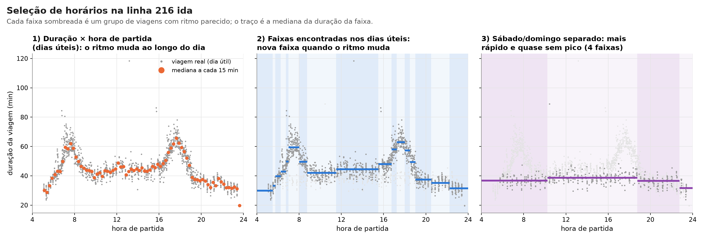
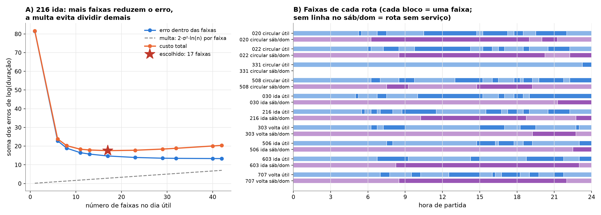

# Faixas horárias por ritmo

Código: [`pipeline/faixas.py`](../pipeline/faixas.py) (`particao_ritmo`, `definir_faixas`).
Parâmetros: `RITMO_SLOT_MIN = 15`, `RITMO_MIN_PERNAS = 20` e `RITMO_FATOR_PEN = 2.0`, em
[`pipeline/config.py`](../pipeline/config.py).



## 1. O problema

Para gerar uma viagem que sai, por exemplo, às 7h40, o gerador precisa decidir
com quais viagens reais vai trabalhar. Um grupo largo demais mistura ritmos
diferentes (o pico das 7h com o vale das 10h) e borra a duração. Um grupo
estreito demais deixa poucas viagens para o k-NN e para o Dirichlet.

Faixas fixas iguais para todas as linhas (madrugada, pico da manhã, ...) não
acompanham o ritmo de cada linha. Por isso, as faixas são escolhidas pelos dados
de cada rota, separadamente para dia útil e para sábado/domingo.

## 2. Dados de entrada

Para cada rota e cada tipo de dia:

- `y = ln(T)`, onde T é a duração da viagem. O log aproxima a duração de uma
  normal (a duração tem cauda longa à direita). Ele também torna a variação
  relativa: 10% a mais conta igual numa rota de 30 min e numa de 90 min.
  E deixa a variância mais parecida entre as horas do dia.
- `h`: hora de partida. O dia é dividido em 96 slots de 15 min, e as
  fronteiras das faixas só podem cair nesses múltiplos.

## 3. Modelo e função objetivo

O modelo é de média constante por faixa:

```
ln(T_i) = μ_j + ε_i,   i na faixa j,   ε_i ~ N(0, σ²)
```

A partição escolhida em K faixas é a que minimiza

```
Custo = Σ_j SSE_j + K · pen,     pen = 2 · σ² · ln(n)
```

e cada faixa precisa ter pelo menos 20 viagens.

| termo | o que é | papel |
|---|---|---|
| `SSE_j = Σ (y_i − ȳ_j)²` | erro de resumir a faixa j pela sua média | sempre cai com mais faixas |
| `pen` | preço de cada faixa | um corte só entra se reduzir o SSE em mais que `pen` |
| `σ²` | média das variâncias de ln(T) dentro de cada hora cheia | dá escala à penalidade: rotas regulares aceitam cortes menores |
| `ln(n)` | n = viagens do tipo de dia | termo do BIC |
| `2` | parâmetros por faixa (média + posição do corte) | ver seção 4 |
| `≥ 20 viagens` | restrição prática | o k-NN usa K = 4 e o Dirichlet precisa de variedade; também segura cortes espúrios do BIC |

O σ² vem de dentro de cada hora, e não da variância de todos os dados, porque
a variância total inclui a diferença entre as horas. Essa diferença é
justamente o sinal procurado, e usá-la inflaria a penalidade.

Slots sem viagens são absorvidos pela faixa vizinha: juntá-los não muda o SSE.

## 4. De onde vem `2 σ² ln(n)`

Ela sai do BIC (critério de Schwarz) aplicado ao modelo da seção 3:

1. `BIC = −2 ln L + p ln n`.
2. Com ruído normal de variância σ², `−2 ln L = SSE/σ² + const`.
3. Uma partição em K faixas tem K médias e K − 1 cortes, ou seja, `p = 2K − 1`.
4. Multiplicando por σ² e descartando constantes:
   `σ²·BIC ≡ SSE + K · 2σ² ln n`.

Esse é o critério de Schwarz para pontos de mudança na média de Yao (1988).
Com fator 1, só as médias contariam como parâmetros.

A teoria supõe viagens independentes e σ² conhecido. Aqui, σ² é estimado, e
viagens do mesmo dia são correlacionadas. Por isso o fator e o mínimo de
viagens foram confirmados por validação cruzada (seção 6).

## 5. Programação dinâmica

O custo é uma soma de custos por faixa. Então o ótimo global exato sai por
programação dinâmica (Optimal Partitioning, Jackson et al., 2005):

```
best[0] = 0
best[b] = min_{a<b} best[a] + SSE(a, b) + pen      (faixa [a, b) com 0 ou ≥ 20 viagens)
```

O SSE de qualquer intervalo sai em tempo constante a partir de somas acumuladas
por slot (número de viagens, Σy e Σy²):

```
SSE(a, b) = Σy² − (Σy)² / m
```

Os cortes são recuperados de trás para frente pelos argumentos mínimos.
São cerca de 4.600 avaliações por rota e tipo de dia.

Com menos de 40 viagens, não há como formar duas faixas válidas, e o dia vira
uma faixa só. Por exemplo, a 331 tem duas faixas no dia útil e não tem serviço
no fim de semana.

Na geração, a hora de início de cada sintética é a partida de uma viagem real
da faixa, sorteada, ±7,5 min.



## 6. Escolha dos parâmetros (validação cruzada por dia)

Protocolo: dias inteiros ficam fora (3 dobras), as sintéticas são geradas com
os dias restantes, e a duração é comparada com a dos dias deixados de fora.
A métrica é o KS médio por hora (menor é melhor).

1. **Ajuste em 7 rotas.** Grade de fator {2; 1; 0,5; 0,25; 0,1} × mínimo
   {20; 40; 80}.
2. **Validação em 18 rotas novas**, sem reajuste:

| estratégia | KS, 18 rotas novas | KS, 7 rotas do ajuste |
|---|---|---|
| ritmo, fator 2, mín. 40 | **0,267** | 0,264 |
| **ritmo, fator 2, mín. 20 (adotada)** | 0,271 | **0,259** |
| ritmo, fator 1, mín. 40 | 0,273 | 0,274 |
| janela de ±60 min + tipo de dia | 0,281 | 0,264 |
| 5 faixas fixas + tipo de dia | 0,323 | 0,311 |
| 5 faixas fixas | 0,333 | 0,323 |

A adotada fica 19% abaixo das faixas fixas e vence em 17 das 18 rotas novas.
Entre as variantes por ritmo, as diferenças (≤ 0,006) são menores que a
variação entre dobras. O fator 2 está na borda da grade testada.

## 7. Relação com a literatura

- **Pontos de mudança na média com BIC:** Yao (1988), *Statistics & Probability
  Letters* 6(3), 181–189.
- **Partição ótima por programação dinâmica:** Jackson et al. (2005), *IEEE
  Signal Processing Letters*, [arXiv:math/0309285](https://arxiv.org/abs/math/0309285).
  Killick, Fearnhead e Eckley (2012), *JASA* 107(500), propõem o PELT,
  [arXiv:1101.1438](https://arxiv.org/abs/1101.1438).
- **Faixas horárias em transporte por agrupamento:**
  - Salicrú, Fleurent e Armengol (2011), *Transportation Research Part A*, com
    classificação hierárquica;
  - Bie, Gong e Liu (2015), com tempos de GPS;
  - Bulut e Yanık (2019), com k-means e fuzzy c-means.

Diferente do agrupamento, a partição por pontos de mudança garante faixas
contíguas e escolhe o número de faixas pelo próprio critério.
